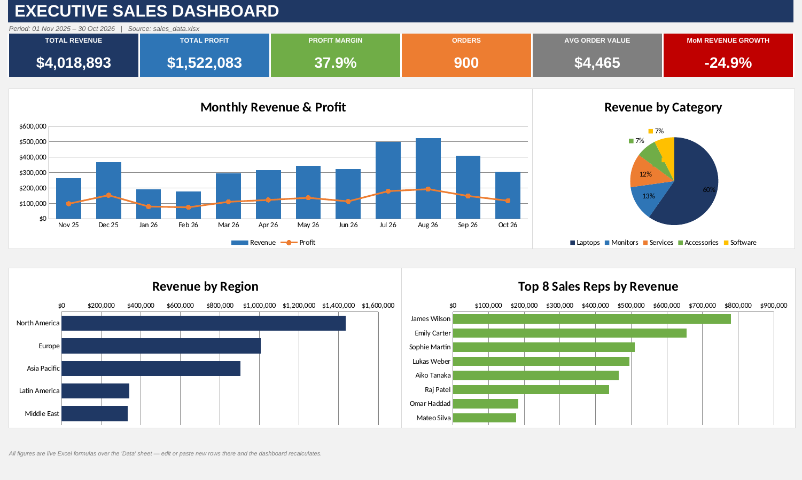

# 📊 Executive Sales Dashboard (Python + Excel)

A Python tool that reads sales data from an Excel file and automatically builds a professional **executive sales dashboard** in Excel — complete with KPI cards and native Excel charts.

All dashboard numbers are **live Excel formulas**, so you can paste new rows into the data sheet and the dashboard updates instantly.



## ✨ Features

- **6 KPI cards:** Total Revenue, Total Profit, Profit Margin, Orders, Average Order Value, Month-over-Month Revenue Growth
- **4 charts:** Monthly revenue & profit trend, revenue by category, revenue by region, top 8 sales reps
- **Formula-driven:** built with `SUMIFS` / `COUNTIFS`, no hardcoded results
- **Excel input:** reads your own `.xlsx` file with pandas
- **Print-ready:** the dashboard fits on one landscape page
- **Sample data included:** generates demo data if no input file is found

## 🛠 Tech Stack

- Python 3.8+
- [pandas](https://pandas.pydata.org/) – reading and validating Excel data
- [openpyxl](https://openpyxl.readthedocs.io/) – building the Excel workbook, formulas and charts

## 📁 Project Structure

```
executive-sales-dashboard/
├── sales_dashboard.py     # Main script
├── sales_data.xlsx        # Sample input data (randomly generated)
├── Sales_Dashboard.xlsx   # Example output
├── dashboard.png          # Screenshot
└── README.md
```

## 🚀 Getting Started

### 1. Clone the repository
```bash
git clone https://github.com/thinukahettigedara/executive-sales-dashboard.git
cd executive-sales-dashboard
```

### 2. Install dependencies
```bash
pip install pandas openpyxl
```

### 3. Run
```bash
python sales_dashboard.py
```
This reads `sales_data.xlsx` and creates `Sales_Dashboard.xlsx`. Open it in Excel — the **Dashboard** sheet is the first tab.

### Use your own data
```bash
python sales_dashboard.py my_sales.xlsx                    # custom input
python sales_dashboard.py my_sales.xlsx report.xlsx        # custom input and output name
python sales_dashboard.py my_sales.xlsx --sheet MySheet    # custom sheet name
```

## 📋 Input Data Format

The input sheet (default name `Sales_Data`) must contain these columns:

| Column | Description |
|---|---|
| `Date` | Order date |
| `Order_ID` | Unique order ID |
| `Region` | Sales region |
| `Category` | Product category |
| `Product` | Product name |
| `Sales_Rep` | Sales representative |
| `Segment` | Customer segment |
| `Units` | Units sold |
| `Unit_Price` | Price per unit |
| `Revenue` | Total revenue |
| `Cost` | Total cost |
| `Profit` | Revenue − Cost *(optional, calculated if missing)* |

## ⚙️ How It Works

1. **Load:** pandas reads and cleans the Excel data (dates, numbers, text).
2. **Build:** openpyxl creates three sheets:
   - `Dashboard`: KPI cards and charts
   - `Summary`: formula tables by month, region, category and sales rep
   - `Data`: a copy of your source rows
3. **Calculate:** Excel computes all formulas when the file is opened.

## 🎨 Customization

Colors, fonts, the number of top reps shown (`TOP_REPS`) and the chart layout are defined at the top of `sales_dashboard.py` and are easy to change.

## ⚠️ Note

The included `sales_data.xlsx` is **randomly generated sample data** for demonstration only.

## 👤 Author

**Thinuka Udara**
GitHub: [@thinukahettigedara](https://github.com/thinukahettigedara)
